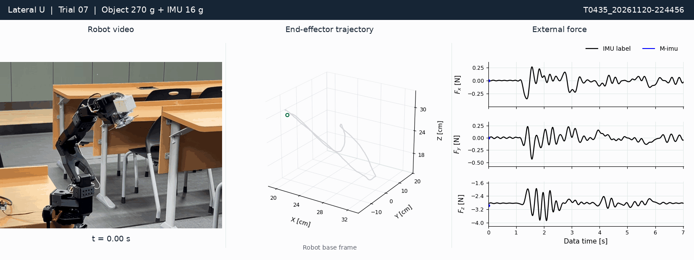
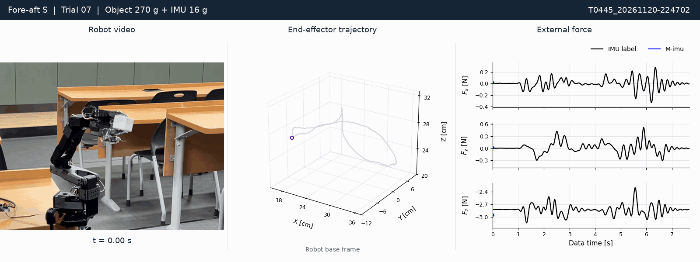

# Learning External Force Estimation on a Low-Cost Robot Arm with IMU-Based Dynamic Force Labels

This research was conducted as an undergraduate capstone design thesis at Inha University.

## Abstract

This study investigates the effect of force-label construction on sensorless external force estimation for the low-cost SO-101 robot arm. Using identical NeuralActuator architectures and training settings, gravity-only and IMU-supervised models are compared. Dynamic 3D force labels are generated from known payload masses and gripper-mounted IMU measurements through calibration, synchronization, and center-of-mass compensation. The IMU is used only for labeling and excluded from inference. Experiments comprise 60 trajectories across three payloads and two motion types. Below 2 Hz, the corrected IMU labels agree with an encoder-based forward-kinematics (FK) reference, with vertical force-difference RMS values of 0.02–0.04 N. On eight held-out trials, the IMU-supervised model achieves unfiltered X/Y/Z MAEs of 0.055/0.065/0.150 N against IMU labels. Against the 2 Hz-filtered FK reference, its X/Y MAEs are 0.042/0.047 N, compared with 2.330/0.131 N for the gravity-supervised model. These results indicate improved low-frequency horizontal force estimation, while higher-frequency evaluation is limited to label reproduction.

## Dataset

SO-101 robot-arm recordings for sensorless external-force estimation: 60 trials, two motion families (lateral U and fore-aft S), and three payload masses. Each payload/motion condition contains 10 randomized trajectories. The object remains grasped throughout each trial.

| Object [g] | IMU board [g] | Total payload [g] | Trials | Train / validation / test |
|---:|---:|---:|---:|---:|
| 270 | 16 | 286 | 20 | 16 / 2 / 2 |
| 405 | 16 | 421 | 20 | 16 / 2 / 2 |
| 540 | 16 | 556 | 20 | 12 / 4 / 4 |
| Total | | | 60 | 44 / 8 / 8 |

## Data

- [Trial manifest](manifest.csv): trial ID, mass, motion family, trajectory number, split, sample counts, recording-time interval, and file paths.
- [Raw logs](data/raw): `arm.csv`, `imu.csv`, `att.csv`, `meta.json`, and `replay.json` for every trial. Raw CSVs are unchanged; local paths in metadata are made portable.
- [Synchronized records](data/synchronized): complete records, including approach and the stationary intervals used for attitude correction.
- [Final IMU-labeled data](data/motion): trajectory-execution intervals used for learning, 44,637 rows in total.
- [Gravity-only labels](data/gravity): `[−999, −999, −mg]`; `−999` masks an unsupervised component.
- Splits: [train, 44 trials](splits/train.txt), [validation, 8 trials](splits/validation.txt), [test, 8 trials](splits/test.txt). Trials are disjoint; all six mass/motion conditions occur in every split.
- [Commanded trajectories](trajectories), [IMU calibration](calibration/imu_alignment.json), [FK model](kinematics/scene.xml), and [column definitions](DATA_FORMAT.md).

Forces are the payload reaction on the robot, expressed in the robot base frame: `F = m(g − a_CoM)`, with `g = [0, 0, −9.81] m/s²`. Total mass includes the 16 g IMU board. The final IMU labels use gyro-propagated attitude with stationary tilt anchors and a fourth-order, zero-phase 5 Hz Butterworth filter.

## Label generation and evaluation

Python 3.10 was used. Install into a virtual environment:

```bash
python3 -m venv .venv
source .venv/bin/activate
python -m pip install -r requirements.txt
python scripts/verify.py
```

[Clock and rigid-body conversion functions](scripts/imu_processing.py) provide sensor-clock fitting, calibrated delays, sensor corrections, and lever-arm compensation. The archived synchronized records already contain these conversions and acquisition-time read repairs. [Label generation](scripts/build_labels.py) starts from those records and reproduces the final attitude-corrected labels and FK reference. Both stationary intervals are retained until correction is complete; only the trajectory interval is then selected.

```bash
python scripts/build_labels.py
python scripts/evaluate.py
```

Outputs are written under `outputs/`. The model receives 42 servo features over nine frames and predicts the next timestamp; normalization uses the 44 training trials only. IMU signals are excluded from model inputs.

[Saved predictions](results/predictions), [per-condition MAEs](results/mae.csv), and [complete metrics](results/metrics.json) cover all eight test trials.

Evaluation reports component-wise MAE against (1) IMU labels, with no filtering beyond label preprocessing, and (2) an FK reference, with the same fourth-order zero-phase 2 Hz filter applied to reference and predictions. FK is a kinematic comparison based on joint measurements, not an independent F/T measurement. Overall values pool test samples rather than averaging trial MAEs.

## Representative trajectories and videos

| Motion | Trial ID | Object / total mass [g] | Trajectory | IMU-label X / Y / Z MAE [N] |
|---|---|---:|---|---|
| Lateral U | `T0435_20261120-224456` | 270 / 286 | [7th, motion_006](trajectories/group1_lateral_u/motion_006/reference.csv) | 0.027 / 0.028 / 0.073 |
| Fore-aft S | `T0445_20261120-224702` | 270 / 286 | [7th, motion_006](trajectories/group1_fore_aft_s/motion_006/reference.csv) | 0.028 / 0.035 / 0.050 |

Left: robot video. Center: end-effector trajectory from measured joint angles and FK. Right: M-imu force prediction (blue) and IMU force label (black). The trajectory marker and force cursor share the displayed data time.

### Lateral U



### Fore-aft S



## NeuralActuator

This work uses the external-force estimation structure of [NeuralActuator](https://arxiv.org/abs/2607.11734). Original code: [Frank-ZY-Dou/Dynamics-Modeling/NeuralActuator](https://github.com/Frank-ZY-Dou/Dynamics-Modeling/tree/main/NeuralActuator).

```bibtex
@inproceedings{dou2026neuralactuator,
  title={{NeuralActuator}: Neural Actuation Modeling for Robot Dynamics and External Force Perception},
  author={Dou, Zhiyang and Onyemelukwe, John U. and Zhang, Hangxing and Zhang, Heng and Guo, Minghao and Tian, Yunsheng and Lipiec, Michal Piotr and Jacob, Joshua and Liu, Chao and Chen, Peter Yichen and Ivanov, Yuri and Matusik, Wojciech},
  booktitle={Proceedings of Robotics: Science and Systems (RSS)},
  year={2026}
}
```

Upstream licenses: [NeuralActuator MIT](licenses/NeuralActuator-MIT.txt), [SO-101 model Apache 2.0](licenses/SO101-Apache-2.0.txt), [Crazyflie model MIT](licenses/Crazyflie-MIT.txt). Modifications are identified in [NOTICE](NOTICE).
